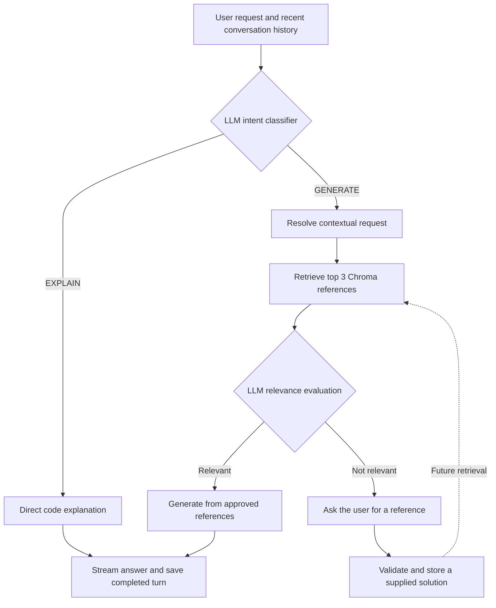

# AI Coding Assistant

A Streamlit application for explaining Python code, generating code from retrieved references, and learning from user-provided solutions. It combines LLM-based intent classification, Chroma retrieval, persistent conversation memory, response streaming, and an external Python execution tool powered by E2B.

Developed by **Nafe Abubaker** during the **AI Engineer Internship at Cellula Technologies — Week 4, Task 4**.

> **External execution:** the default runner sends reviewed Python source to a fresh E2B sandbox. It returns stdout, stderr, and the actual process exit code. The optional local backend uses the current user's operating-system permissions and is intended for your own computer.

## Features

| Feature | Behavior |
|---|---|
| Intent classification | An LLM classifies each chat request as `EXPLAIN` or `GENERATE`, using recent conversation context. |
| Direct explanation | Explains supplied or previously discussed code directly, without vector retrieval. |
| Retrieval-augmented generation | Retrieves programming references from Chroma before generating code. |
| Relevance evaluation | A separate LLM evaluates the retrieved references; generation uses only approved reference IDs. |
| Feedback learning | Requests a reference when knowledge is insufficient, then stores an uploaded solution for future retrieval. |
| Persistent memory | Saves conversation turns in SQLite and reloads them by conversation ID. |
| Response streaming | Displays generation and explanation text as it arrives from the model. |
| Code execution | Sends a selected Python block to an external E2B sandbox and captures output, errors, and exit status. |
| Source visibility | Displays reference IDs and the relevance evaluator's explanation. |

## Workflow



The **Run code** button passes a selected generated Python block to the execution tool. Execution results are recorded as another conversation turn so later questions can refer to both the code and its output.

Learning adds reference documents and embeddings to Chroma. It does **not** fine-tune the LLM.

## Technology stack

| Component | Technology |
|---|---|
| Application | Python; development environment: Python 3.11.9 on Windows 11 |
| Interface | Streamlit |
| LLM integration | LangChain `ChatOpenRouter` |
| LLM provider | OpenRouter; model selected through `OPENROUTER_MODEL` |
| Reference store | Persistent Chroma collection: `coding_knowledge` |
| Embeddings | Chroma's default ONNX `all-MiniLM-L6-v2` embedding function, 384 dimensions |
| Retrieval | Cosine distance; default top-k: 3 |
| Conversation storage | SQLite |
| Response validation | Pydantic |
| Dataset preparation | PyArrow and Parquet support |
| Execution | E2B Code Interpreter SDK; optional local subprocess backend |

## Setup and run

### 1. Open the project directory

Clone or download this repository. Open a terminal in the directory containing `coding_assistant_app.py`, `requirements.txt`, and the other application modules.

### 2. Create a virtual environment and install dependencies

**Windows Command Prompt:**

```bat
python -m venv .venv
.venv\Scripts\activate
python -m pip install -r requirements.txt streamlit
```

**macOS or Linux:**

```bash
python3 -m venv .venv
source .venv/bin/activate
python -m pip install -r requirements.txt streamlit
```

The installation command explicitly includes Streamlit, which is needed for the interface. The virtual environment should remain active when running the commands below.

### 3. Configure OpenRouter

Create a `.env` file in the application directory:

```env
OPENROUTER_API_KEY=your_openrouter_api_key_here
OPENROUTER_MODEL=qwen/qwen3-coder
CODE_RUNNER_BACKEND=e2b
E2B_API_KEY=your_e2b_api_key_here
```

Create an API key through [OpenRouter](https://openrouter.ai/keys). `qwen/qwen3-coder` is the model used in the successful development runs and is a **paid model**. Check its [current pricing and availability](https://openrouter.ai/qwen/qwen3-coder) before making requests.

The model is configurable. Availability, structured-output behavior, and quotas vary between models and providers. A specific model suitable for coding and JSON instructions gives more consistent behavior than randomly routing across free models.

Keep `.env` out of Git. Restart the app after changing its configuration.

Create an [E2B account and API key](https://console.e2b.dev/) to enable execution. E2B's Hobby plan currently includes $100 in one-time credits; sandbox usage is metered. Check [current pricing](https://e2b.dev/pricing). Explanation and generation still work when the runner key is absent, but Run code is disabled.

For a local-only subprocess runner, set `CODE_RUNNER_BACKEND=local` and `ALLOW_LOCAL_CODE_EXECUTION=true` in `.env`. This mode requires no E2B key and must remain restricted to your own computer.

### 4. Prepare the reference database

The initial reference corpus contains **164 HumanEval programming examples**. Each task is stored as a complete reference document, keeping its problem description and reference implementation together.

Download the test Parquet file from the [HumanEval dataset page](https://huggingface.co/datasets/openai/openai_humaneval) and place it at:

```text
data/test-00000-of-00001.parquet
```

Then run:

```bat
python prepare_dataset.py
python build_knowledge_base.py
```

Preparation creates `output/humaneval_documents.json`. Building the knowledge base generates embeddings and stores the documents, metadata, and vectors in `chroma_db/`.

The builder uses `upsert()` for the HumanEval records rather than clearing the collection. Repeating the build updates the same base IDs. User feedback is stored under separate `feedback_...` IDs.

The embedding model may need to download its files on first use. Internet access is also required for LLM and E2B requests. If a working Chroma database already exists, you can proceed to launching the app. The Streamlit interface also initializes missing HumanEval references automatically on startup from the Parquet dataset, retaining existing references.

### 5. Launch Streamlit

```bat
python -m streamlit run coding_assistant_app.py --server.address 127.0.0.1 --server.fileWatcherType none
```

Open the Local URL printed in the terminal, usually [http://127.0.0.1:8501](http://127.0.0.1:8501).

This command binds the server to the local computer. File watching is disabled; after changing the application files, stop the server with **Ctrl+C** and run the command again.

## Using the assistant

### Explain code

Paste code into the chat and ask for an explanation:

```text
Explain this code: print("Hello, My name is Nafe")
```

Follow-ups such as `I need further explanation` use the recent conversation history. The explanation route makes no Chroma search.

### Generate code

Describe the required behavior and include examples when useful:

```text
Write a Python function that removes duplicates from a list while keeping
the first occurrence of each value. Include a runnable example.
```

The assistant retrieves references, evaluates their relevance, and generates an answer from the approved documents. Open **Sources and relevance** to inspect the reference IDs and evaluation reason.

### Run a generated Python block

1. Configure `E2B_API_KEY` and enable **code execution** in the sidebar.
2. Review the generated source under **Review selected Python code**.
3. Select a block if the answer contains multiple Python blocks.
4. Click **Run code**.

The result shows the runner, execution status, actual exit code, standard output, and standard error. Running saved code makes an E2B request without another LLM request. A function definition alone may execute successfully without printing anything; include explicit calls or print statements to observe results.

The router passes the selected source string to `execute_code()`. In E2B mode, that tool creates a fresh sandbox, uploads the source as a script, starts Python, captures both output streams, and destroys the sandbox after the attempt. It disables outbound internet and public sandbox access, forwards no application credentials into the sandbox, caps captured output at 16 KiB, and applies a command timeout. Provider failures return `RUNNER_ERROR`; they never fall back to executing on the Streamlit host. Results remain in conversation memory for later explanation.

### Supply a missing reference

When a request returns `NEEDS_REFERENCE`, the interface offers a **Provide a reference for the unanswered request** section.

Upload a UTF-8 `.py` or `.txt` implementation and click **Save reference**. The router links it to the pending request, checks Python syntax, creates metadata and embeddings, and upserts the reference into Chroma. A successful save returns `LEARNED`.

The same normalized request, solution, and language produce a stable SHA-256-based ID. Repeating identical input updates that record. A changed request or implementation produces a different ID.

Saved references are available to future retrieval in **other conversations**. The `syntax_only` validation label confirms parsing, not functional correctness; the learning operation does not execute the supplied code.

### Manage conversations and sidebar settings

| Control | Purpose |
|---|---|
| New conversation | Starts a conversation with a new ID. Existing saved conversations remain available. |
| Active conversation | Displays the current ID. Copy it to reload the conversation later. |
| Conversation ID to load | Enter a saved ID, such as `memory_check`, then click **Load conversation**. |
| Enable code execution | Enables Run buttons when the selected backend is configured. Execution starts only when a button is clicked. |
| Timeout in seconds | Sets the execution limit; the default is 5 seconds. |
| Stream responses | Displays answer text as the model produces it. Classification and relevance processing happen first. |
| Show diagnostic details | Reveals context/relevance failure metadata when available. It only changes the display. |
| Configured model | Shows the model selected in `.env`, with a pricing reminder when applicable. |

Conversation IDs are labels, not API keys or access credentials. CLI IDs come from `--conversation`; UI-created IDs begin with `ui_`.

## Command-line examples

The same backend can be used without Streamlit. Run these commands from the application directory with the virtual environment active.

**Generate and execute a self-contained example:**

```bat
python assistant_router.py "Write has_close_elements(numbers, threshold), returning True when any two distinct numbers are closer than threshold. Include print(has_close_elements([1.0, 2.0, 3.0], 0.5)) and print(has_close_elements([1.0, 2.8, 3.0], 0.3)) in exactly one Python code block." --conversation demo --execute
```

Expected execution output:

```text
False
True
```

**Explain the previous result:**

```bat
python assistant_router.py "Explain how the previous code and output worked." --conversation demo
```

**Save a reference for a pending `NEEDS_REFERENCE` request:**

Save your implementation in `my_solution.py`, then use the same conversation ID as the unanswered request:

```bat
python assistant_router.py "Use this corrected implementation for the previous request." --conversation feedback_demo --solution-file my_solution.py
```

**Check retrieval or test the runner independently:**

```bat
python retrieve_code.py "Write a function that checks whether two numbers are closer than a threshold."
python execute_code.py --demo
```

| Router option | Purpose |
|---|---|
| `--conversation NAME` | Load and save history under this ID. |
| `--execute` | Execute a selected block after successful generation. |
| `--code-block N` | Select a Python block, numbered from 1; requires `--execute`. |
| `--timeout SECONDS` | Set the execution time limit. |
| `--solution-file FILE` | Supply an implementation for the pending request. |
| `--debug-context` | Print context-resolution diagnostics when available. |

The runner demonstration covers successful output, a captured runtime error, and stopping an infinite loop. It requires no LLM requests. In E2B mode it creates three sandboxes and consumes service credits. In explicit local mode it makes no external requests.

## Deploy on Streamlit Community Cloud

Choose `coding_assistant_app.py` as the entry point. Keep `data/test-00000-of-00001.parquet` in the repository; startup builds any missing HumanEval references. Keep credentials and local database state excluded from Git.

Add these root-level entries to **App settings → Secrets**, replacing both key placeholders:

```toml
OPENROUTER_API_KEY = "your_openrouter_api_key_here"
OPENROUTER_MODEL = "qwen/qwen3-coder"
CODE_RUNNER_BACKEND = "e2b"
E2B_API_KEY = "your_e2b_api_key_here"
ALLOW_LOCAL_CODE_EXECUTION = false
```

Commit the updated dependencies and app files, then reboot the app. Enable **code execution** and click **Run code** on a generated Python block. With the E2B backend, the local-execution setting can stay false.

Cloud, Codespaces, and your Windows installation each have their own configuration and database files. Existing local feedback and conversations are not copied by deployment. Re-upload a learned reference in the hosted app when needed. This prototype's reference corpus is shared between its users, and history IDs are labels rather than authentication. The app does not provide account-level access controls.

## Project structure

| File | Responsibility |
|---|---|
| `coding_assistant_app.py` | Streamlit chat, sidebar controls, reference uploads, execution display, and streamed answer updates. |
| `assistant_router.py` | Intent-based routing, history loading, feedback handling, optional execution, and turn persistence. |
| `intent_classifier.py` | LLM classification into `EXPLAIN` or `GENERATE`. |
| `context_resolver.py` | Converts contextual generation follow-ups into standalone retrieval requests. |
| `explain_code.py` | Direct code explanation and its existing explanation prompt. |
| `generate_code.py` | Retrieval, relevance evaluation, approved-reference generation, and source attribution. |
| `answer_streaming.py` | Visible-text streaming, completed-answer collection, and streamed explanations. |
| `relevance_evaluator.py` | Validates the relevance decision and selected reference IDs; retries invalid output once. |
| `retrieve_code.py` | Similarity retrieval from the reference collection. |
| `vector_store.py` | Shared Chroma connection and embedding configuration. |
| `learn_from_feedback.py` | Syntax checking, stable reference IDs, metadata creation, and Chroma upserts. |
| `conversation_memory.py` | SQLite storage and retrieval of conversation turns. |
| `execute_code.py` | External E2B runner, configuration checks, output limits, cleanup, and optional local subprocess execution. |
| `prepare_dataset.py` | Converts the HumanEval Parquet data into reference documents. |
| `build_knowledge_base.py` | Embeds and upserts the initial HumanEval corpus. |
| `requirements.txt` | Project dependencies. |

Setup scripts are retained for rebuilding the reference corpus. Development-only scripts such as `test_llm.py` and `inspect_dataset.py` are not required by the running app.

## Data and memory

| Path | Contents |
|---|---|
| `data/test-00000-of-00001.parquet` | Original HumanEval dataset. |
| `output/humaneval_documents.json` | Prepared reference documents and associated data. |
| `chroma_db/` | Persistent base references, learned references, metadata, and vectors. |
| `memory_db/conversations.sqlite3` | Saved questions, answers, and execution results, grouped by conversation ID. |

The reference collection is shared across conversations. Conversation history is scoped by ID. The classifier and answer routes receive the latest **four usable turns**; contextual generation also uses that history to resolve the request. The interface displays up to **100 recent saved turns**.

Context, relevance, and feedback failures are treated as transient errors and excluded from saved history. Interrupted streams stay out of persistent memory; any partial text is displayed separately without execution controls.

Keep the local databases if you want to retain learned references and conversation history. A fresh installation builds the HumanEval corpus and learns additional references through feedback.

### Git hygiene

Keep credentials, virtual environments, caches, and local database state out of the repository. Suggested `.gitignore` entries:

```gitignore
.env
.venv/
__pycache__/
*.py[cod]
chroma_db/
memory_db/
output/
.streamlit/secrets.toml
```

Publish the setup scripts and instructions so another user can initialize their own database. Add a project license separately if you choose one.

## Limitations

- **Generated code needs review and testing.** LLM relevance decisions and generated implementations can be wrong. Successful execution confirms that a snippet ran; it does not establish algorithmic correctness.
- **Execution is Python-only.** E2B runs source in a separate sandbox. The optional local backend retains the current user's filesystem and network permissions. There is no public-user authentication or authorization layer in this prototype.
- **Each external run starts fresh.** Standard input is closed, outbound internet is disabled, and project-relative files are absent. Packages come from the E2B template rather than the app's virtual environment. Dependencies are not installed automatically, and files or variables are not retained between runs.
- **Execution is bounded.** The default command timeout is 5 seconds and captured output is limited to 16 KiB across stdout and stderr. Sandbox startup and upload add time before execution. Long-running servers and training jobs are unsuitable for this runner. A timeout or output-limit stop may have no exit code because the command was interrupted.
- **Feedback is syntax-checked.** Uploaded implementations are stored as references without automatic functional verification.
- **Context is bounded.** Older turns remain in SQLite but are outside the recent history window supplied to the LLM.
- **Provider behavior varies.** Model availability, request limits, output formatting, and token budgets can affect responses. Diagnostics help identify these failures.
- **Storage is local to each app instance.** Long-term hosting requires durable Chroma and SQLite storage and appropriate access controls. The hosted execution backend is external, but conversation and reference storage remain on the app server.
- **External execution requires an E2B account.** Trial credits are finite and usage is metered. Invalid keys, exhausted credits, service limits, and service outages produce runner errors.

HumanEval is used here as a **retrieval reference corpus**. The application does not automatically run the official HumanEval benchmark or report `pass@k` scores.

## Troubleshooting

| Symptom | What to check |
|---|---|
| `No endpoints found` | Check the configured model's current availability and your provider/account settings, then restart the app after changing `.env`. |
| Rate-limit or quota error | Check your OpenRouter request allowance and credit balance before retrying. |
| `CONTEXT_ERROR` | Inspect context diagnostics. Include the full request or referenced code if the follow-up cannot be resolved reliably. |
| `EVALUATION_ERROR` | Inspect relevance diagnostics. The evaluator rejected invalid output after two attempts; generation did not proceed. |
| `NEEDS_REFERENCE` | Supply an implementation for the unanswered request using the upload panel or `--solution-file`. |
| `FEEDBACK_ERROR` | Check Python syntax and confirm that the same conversation has a pending `NEEDS_REFERENCE` request. |
| Execution `SKIPPED` | Check for a complete block marked `python` or `py`. Select a block if more than one is present. |
| Execution succeeds with empty stdout | Add explicit function calls or print statements to the generated program. |
| Run code is disabled | Set `CODE_RUNNER_BACKEND=e2b` and a valid `E2B_API_KEY`; install the updated requirements and enable code execution. |
| Runner reports authentication or service errors | Check the E2B API key, credits, service availability, and account limits. |
| `TIMEOUT` or `OUTPUT_LIMIT` | Reduce the workload or output; adjust the timeout when appropriate. |
| Conversation does not load | Copy the exact saved ID from the sidebar or the CLI's `--conversation` value. |
| Code changes do not appear | Stop and restart Streamlit; the documented launch command disables file watching. |

## Verified behavior

Development included the following functional checks:

| Scenario | Observed result |
|---|---|
| `has_close_elements` generation | Used `HumanEval/0`; the requested examples printed `False` and `True`. |
| Direct explanation and follow-up | Explained supplied code and retained its context for further questions. |
| Conversation reload | Loaded stored history through the Streamlit sidebar. |
| Code execution and explanation | Captured output and supplied it in later conversation context. |
| Repeated feedback submission | Kept the same reference ID and document count for identical input. |
| Missing linked-list knowledge | Returned `NEEDS_REFERENCE`, then accepted and stored an uploaded solution. |
| Learned reference in a new conversation | Retrieved the saved linked-list implementation and generated an executable reversal example. |
| Linked-list reversal example | Printed `[0,1,2,3]` before reversal and `[3,2,1,0]` afterward. |
| Runtime failure and infinite loop | Captured `ZeroDivisionError` and returned `TIMEOUT`. |
| Streamed generation and explanation | Both routes displayed text progressively in the live interface. |

These checks document application behavior during development. They do not establish benchmark accuracy or comprehensive test coverage.

The external-runner update also includes offline adapter checks:

```bat
python -m unittest discover -s tests -v
```

They cover source forwarding, stdout/stderr separation, actual exit-code handling, timeout, output limits, cleanup, configuration failures, and routing/memory integration. External calls are mocked; small local programs run through the real subprocess backend. A live E2B execution must be verified using your configured API key after deployment.

## References and acknowledgments

- [OpenAI HumanEval](https://github.com/openai/human-eval) — programming problems and reference implementations.
- [HumanEval dataset on Hugging Face](https://huggingface.co/datasets/openai/openai_humaneval) — Parquet dataset source.
- [LangChain OpenRouter integration](https://docs.langchain.com/oss/python/integrations/chat/openrouter).
- [Chroma documentation](https://docs.trychroma.com/).
- [Streamlit documentation](https://docs.streamlit.io/).
- [E2B quickstart](https://docs.e2b.dev/quickstart) — external sandbox setup.
- [E2B pricing](https://e2b.dev/pricing) — trial credits and metered usage.
